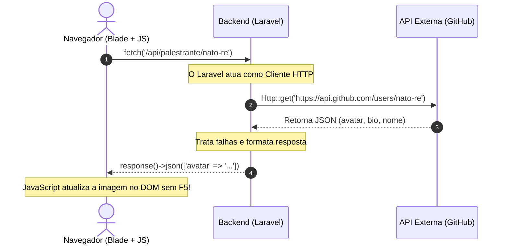

# 🌐 Consumo de APIs: O Ciclo HTTP Ponta a Ponta (`Http::get` & `fetch`)

No desenvolvimento web profissional, a aplicação raramente vive isolada. Ela precisa se comunicar:
- **O Backend conversa com o mundo exterior** (consumindo APIs de pagamento, clima, CEP ou GitHub).
- **O Navegador conversa com o Backend** (disparando requisições assíncronas em segundo plano via JavaScript para atualizar o HTML sem piscar a tela).

Embora sejam linguagens diferentes (PHP no servidor e JavaScript no cliente), **o protocolo HTTP e o ciclo de dados são exatamente os mesmos**.

---

## 🧭 O Ciclo de Comunicação (Padrão BFF / Proxy)

Em vez do navegador chamar APIs externas diretamente (o que expõe chaves secretas e gera problemas de CORS), usamos o Laravel como intermediário seguro:



---

## 1. O Backend como Cliente: Facade `Http::get` no Laravel

O Laravel fornece um cliente HTTP extremamente expressivo baseado em Guzzle:

```php
use Illuminate\Support\Facades\Http;

public function buscarPalestrante(string $username)
{
    try {
        // 1. Timeout obrigatório: se a API externa travar, não derruba o nosso servidor!
        $response = Http::timeout(3)->get("https://api.github.com/users/{$username}");

        // 2. Programação defensiva: confere se a resposta foi HTTP 200 OK
        if ($response->successful()) {
            $dados = $response->json();
            return response()->json([
                'nome'   => $dados['name'] ?? $username,
                'avatar' => $dados['avatar_url'] ?? null,
                'bio'    => $dados['bio'] ?? 'Sem bio informada.',
            ]);
        }
    } catch (\Exception $e) {
        // Fallback gracioso: registra log e não quebra a tela do usuário
    }

    // Retorno fallback se a API falhar
    return response()->json([
        'nome'   => $username,
        'avatar' => 'https://ui-avatars.com/api/?name=' . urlencode($username),
        'bio'    => 'Perfil indisponível no momento.',
    ]);
}
```

---

## 2. O Frontend como Cliente: `fetch()` no JavaScript (Blade)

No navegador, usamos a função nativa `fetch()` para buscar o JSON retornado pelo Laravel e atualizar elementos do DOM sem dar F5 na página:

```blade
<!-- resources/views/eventos/palestrante.blade.php -->
<div class="card p-4">
    <div class="flex items-center gap-4">
        <input type="text" id="github-user" placeholder="Usuário do GitHub (ex: nato-re)" class="form-control">
        <button type="button" onclick="carregarPerfil()" class="btn btn-primary">
            🔍 Buscar do GitHub
        </button>
    </div>

    <!-- Elementos dinâmicos atualizados pelo JavaScript -->
    <div class="mt-4 flex items-center gap-4">
        
        <div>
            <h4 id="nome-text" class="font-bold text-lg">Aguardando busca...</h4>
            <p id="bio-text" class="text-gray-600 text-sm">Digite o usuário e clique no botão.</p>
        </div>
    </div>
</div>

<script>
function carregarPerfil() {
    const username = document.getElementById('github-user').value.trim();
    if (!username) return alert('Digite um usuário válido!');

    // 1. Dispara a requisição assíncrona ao Laravel
    fetch('/api/palestrante/' + encodeURIComponent(username), {
        headers: { 'Accept': 'application/json' }
    })
    .then(response => {
        if (!response.ok) throw new Error('Falha ao obter dados');
        return response.json(); // 2. Converte corpo da resposta para objeto JS
    })
    .then(data => {
        // 3. Atualiza o DOM dinamicamente
        document.getElementById('avatar-img').src = data.avatar;
        document.getElementById('nome-text').innerText = data.nome;
        document.getElementById('bio-text').innerText = data.bio;
    })
    .catch(error => {
        console.error('Erro na requisição:', error);
        alert('Não foi possível carregar o perfil.');
    });
}
</script>
```

---

## 💡 Por que isso é Essencial?

1. **Evita o piscar de tela (UX Profissional):** Em vez de recarregar a página inteira apenas para validar uma informação ou atualizar um contador de votos, o `fetch()` manipula apenas o pedaço de HTML necessário.
2. **Desacoplamento:** O mesmo endpoint `/api/...` pode alimentar uma view Blade, um aplicativo mobile Flutter/React Native ou um telão de auditório em tempo real.
3. **Segurança:** O frontend nunca consome APIs com credenciais ou tokens diretamente no código JS. Quem faz a intermediação é o backend Laravel.

---

## 🔗 Conceitos Relacionados
- [[Conceitos/HTTP/requisicao|Requisições HTTP & Status Codes]]
- [[Conceitos/HTTP/controller|Controllers no Laravel]]
- [[Conceitos/Frontend/blade|Blade Templating]]
